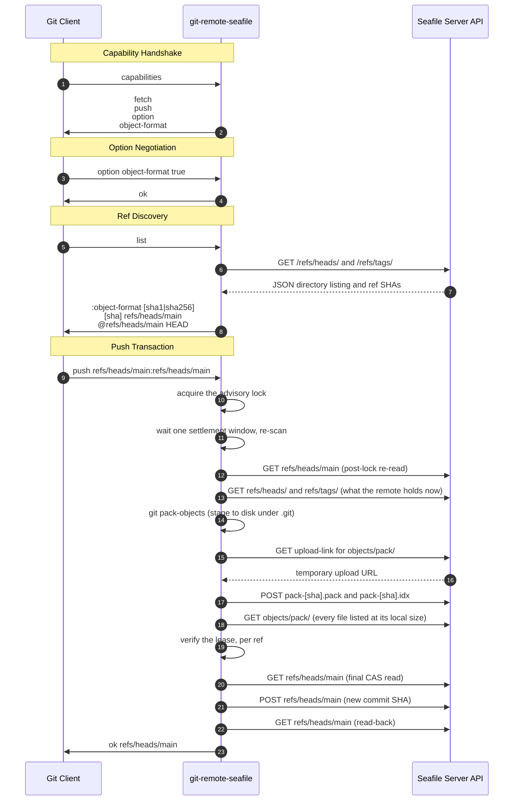

# Architecture & Design Specification: git-remote-seafile

**Status**: implementation reference for v0.8.5 — describes what the code does *today*.  
Per-release history lives in [CHANGELOG.md](CHANGELOG.md), not here.

**Repository**: [tkittich/git-remote-seafile](https://github.com/tkittich/git-remote-seafile)  
**Upstream interest**: [haiwen](https://github.com/haiwen) (Seafile ecosystem) — see §8

**Companion documents**: [USER_GUIDE.md](USER_GUIDE.md) (operator-facing), [SECURITY.md](SECURITY.md)  
(credentials, threat model, reporting), [RUNBOOK.md](RUNBOOK.md) (recovery procedures),  
[SNAPSHOT.md](SNAPSHOT.md) (the whole-tree capture tool).

---

## 1. Executive Summary

`git-remote-seafile` introduces native Git remote support for Seafile servers using Git's standard Remote Helper specification (`gitremote-helpers(7)`).

It allows Seafile users and organizations to use existing Seafile libraries for private, TLS-secured, access-controlled Git repository hosting without:

1. Deploying a separate Git server (e.g. GitLab, Gitea), or
2. Experiencing the performance thrashing and data corruption that occurs when placing live `.git/` working trees inside desktop-synced folders.

The helper is a **transport**: it moves commits. A commit contains only what the repository's `.gitignore` permits, so a companion tool captures the rest — see §4.10.

---

## 2. Background & Problem Statement

Seafile's desktop synchronization client (`seaf-daemon`) is designed for document and file synchronization. When developers store active code repositories within synced libraries (e.g. `Documents/code/`), pathological failure modes emerge:

1. **Continuous Thrashing**: Git operations frequently write to `.git/` (`index.lock`, `objects/tmp_obj_*`, `COMMIT_EDITMSG`, `refs/heads/*`). Each write triggers full-library re-index cycles (hundreds of cycles daily).
2. **Lock Synchronization**: Ephemeral `.git/*.lock` files are synced across devices, locking Git on secondary machines.
3. **Conflict Storms**: When two machines edit code concurrently, the sync daemon generates `* (SFConflict ...).*` duplicate files rather than performing a 3-way line merge.

Attempting to fix this by modifying the desktop client to understand Git is technically fragile due to platform differences, stat cache discrepancies in `.git/index`, and concurrent worktree races.

### 2.1 Why Client-Side Daemon Patches Fail (Case Study: `vacaboja/seafile`)

Recent community efforts (such as the `vacaboja/seafile` fork and [PR #2988](https://github.com/haiwen/seafile/pull/2988) to `haiwen/seafile`) attempted to solve Git object loss by modifying the Linux sync daemon (`daemon/wt-monitor-linux.c`):

- **The specific bug addressed**: Upstream Seafile intentionally ignores `IN_CREATE` for regular files, assuming GUI copy tools will later fire `IN_CLOSE_WRITE`. When Git creates objects or packfiles via the `link(2)` syscall (hard links) or atomic link-renames, `IN_CREATE` fires on the directory, but **no file descriptor is opened or closed**. Upstream Seafile drops `IN_CREATE`, misses the file entirely, and silently omits the Git object from server uploads ([haiwen/seafile#2677](https://github.com/haiwen/seafile/issues/2677), [#2833](https://github.com/haiwen/seafile/issues/2833)).
- **The fork's workaround**: Queues `IN_CREATE` events in a 1-second timeout hash table (`recheck_accu`) and checks if nanosecond `st_mtim` remains unchanged, synthesising a deferred `WT_EVENT_CREATE_OR_UPDATE`.
- **Why client-side patches remain fundamentally insufficient**:
  1. **Platform-isolated**: The patch is strictly Linux-only (`wt-monitor-linux.c`), ignoring Windows and macOS.
  2. **Multi-file race conditions**: Commits write loose objects, `.git/index`, and `refs/heads/*` non-atomically. Asynchronous HTTP block syncing means peers can receive an updated branch ref before the underlying object blocks finish uploading, crashing commands with `fatal: bad object HEAD`.
  3. **Lock file propagation**: `.git/*.lock` files still sync across devices, freezing active repositories on secondary machines.
  4. **Merge conflicts**: Offline or simultaneous commits continue generating unresolvable `(SFConflict ...)` files rather than 3-way Git merges.

### 2.2 The Windows Dilemma: Same-Second Edits & Mandatory File Locks

On Windows systems, desktop syncing of active code introduces additional OS-level failure modes:

1. **1-Second `mtime` Truncation ("Racy Sync")**:  
   Seafile's index format (`common/index/index.c`, adapted from Git's internal directory cache) tracks modification timestamps in integer seconds (`ce_mtime.sec`). Standard Windows CRT file stats truncate `st_mtime` to whole seconds. If an automated script, compiler, or Git command modifies a file multiple times within the **same second** without altering the byte length:
   ```text
   Disk mtime == Index mtime  AND  Disk size == Index size
   ```
   Seafile concludes the file is unchanged, silently skipping the update until a later touch or full library rescan.
2. **Mandatory File Locking (`ERROR_SHARING_VIOLATION` / Error 32)**:  
   Unlike Linux advisory locks, Windows enforces mandatory sharing locks. When Seafile detects `FILE_NOTIFY_CHANGE_LAST_WRITE` via `ReadDirectoryChangesW` (`wt-monitor-win32.c`), it immediately opens the file for block hashing. Rapid atomic saves (`write temp` -> `rename`) or Git index updates collide with Seafile's open read handle, resulting in `Permission denied` errors in editors and compilers.
3. **`ReadDirectoryChangesW` Event Overflows**:  
   Rapid bursts of filesystem operations (e.g. `git checkout` or `git rebase` touching dozens of files in milliseconds) easily overflow the client's 1 MB event buffer (`ERROR_NOTIFY_ENUM_DIR`), forcing costly full-library directory rescans after temporary Git lock files have already vanished.

### 2.3 The Approach: an API-Driven Git Remote Helper

Instead of synchronizing the local `.git/` directory, the developer's working tree remains completely outside Seafile's file watcher. Git uses Seafile Server as an authentic remote destination over the standard **Seafile Web API (`/api2`)**.

---

## 3. Invariants

These hold on every code path, and each is the reason some check below exists. They are stated as obligations on the implementation, not as descriptions of any one release.

### 3.1 Transport

- **Objects travel as packs, never loose.** Every `git push` transfers exactly two files per pack — `.pack` and `.idx` — regardless of commit size. A standard commit's dozens of loose objects would otherwise become dozens of HTTP requests.
- **Refs are written last.** A ref must never name an object the remote does not already hold. Objects upload first; the ref write is the commit point.
- **The helper does not touch tracked content.** Push and fetch never modify the working tree, the index, or local refs. Packs are staged on disk under `.git` and streamed to Seafile with `StreamingMultipartFile`, without buffering gigabyte payloads in memory; the staging directories are removed in a `finally`.
- **One sanitizer, one direction.** Every `error <dst>` protocol line goes to `stdout` through the same sanitizer; human-readable diagnostics go to `stderr`. Mixing them corrupts the wire protocol.

### 3.2 Storage

- **The remote layout is bare-like and nothing else is assumed to exist.** `HEAD`, `refs/heads/*`, `refs/tags/*`, `objects/pack/`, and the lock directory. A repository is readable by any client that follows the layout, without a local database.
- **Every remote-supplied name is validated before use.** Packfile names must match a strict regex; ref names must satisfy the rules of `git check-ref-format` as measured, not as assumed.
- **Refs are the only source of truth.** The helper keeps no cache of remote state between invocations. This costs efficiency (§7) and buys the property that two machines cannot disagree about the remote because of stale local state.

### 3.3 Concurrency

- **The lock is advisory, and is never what makes a write safe.** Seafile exposes no atomic server-side primitive — `replace=1` is last-writer-wins and `replace=0` renames rather than failing — so no scheme built from files and clocks can provide true mutual exclusion. The lock reduces contention; correctness rests on §3.4.
- **Time decides who waits, never who holds.** A ticket's grant marker ranks it; a clock estimate may only break ties among peers (§4.4).
- **Every destructive step re-proves ownership immediately before it acts** — before a ref is written, and before each individual packfile is deleted.
- **A lost race is loud.** Where a check and a write cannot be made atomic, the write is followed by a read-back, and a mismatch is reported as a failure rather than assumed to be success.
- **No external command runs unbounded.** Every `git` invocation is bounded by a wall-clock ceiling, and a timeout is a failure rather than a silent truncation. The bound protects the lease as much as the run: a wedged `git repack` or `index-pack` inside `gc` would otherwise hold the remote lock open past its expiry, at which point another client lawfully takes over (§4.4). The ceiling is raisable, but only from a scope the repository cannot reach — `SEAFILE_GIT_TIMEOUT`, or `seafile.gittimeout` in the system or global git config (§4.8) — because a repository must not be able to raise the ceiling that protects its own concurrency guarantee. The default is deliberately short of what a multi-GB repository needs; the machine owner, not the repository, is who raises it.

### 3.4 Data safety

- **Nothing is deleted until its replacement is proven present.** The consolidated packfiles must be listed back at their expected sizes before any superseded pack is removed (§4.5).
- **A refusal beats a guess.** Configuration that is contradictory, a remote that cannot be read, a probe that cannot answer — each is an error, not a default. The recurring failure this prevents is the silent one.
- **Ambiguity is reported, never resolved silently.** The snapshot tool's excludes are opt-in for exactly this reason: `node_modules` is reproducible, `.env` is not, and the tool cannot tell them apart.
- **The source tree of a capture is read-only.** The snapshot tool's vault is a *second* repository whose work-tree is the source; the source's index and refs are never written (§4.10).

---

## 4. Protocol

### 4.1 Wire Protocol (Git Core ↔ Helper)




**Capability matrix.** What the helper advertises and what it deliberately does not:

| Feature | Status | Notes |
| --- | --- | --- |
| `fetch`, `push` | Advertised | Pack-based; refs are plain files (§4.2) |
| `option object-format` | Advertised | The format is reported from the refs themselves; an explicit algorithm is accepted and the remote's real format wins |
| `option dry-run` | Accepted | `git push --dry-run` reports without a lock or a write |
| `option cas <ref>:<sha>` | Accepted | `git push --force-with-lease`. A push over a lease may rewrite history, but only over the value the user saw (an empty value means "must not exist"); otherwise `stale info`. Updates, deletions and `--dry-run`. A value not of that shape is `unsupported` |
| `option progress`, `option verbosity` | Accepted | No effect |
| any other `option` | `unsupported` | Git then proceeds without it |
| Atomic push (`--atomic`) | Not supported | There is no multi-ref transaction on a file store; refs are written one at a time under the lock, each read back |
| Push options (`-o`), `followtags`, signed pushes | Not supported | Not advertised, so git refuses them up front |
| Peeled tag lines (`^{}`) | Not advertised | Git peels locally after fetching the objects |
| `stateless-connect`, `import`/`export` | Not supported | Packs are transferred whole, not negotiated |

The ref is not written with a single request that is itself atomic. Seafile has no compare-and-swap on a path, so the sequence is: re-read the destination ref *after* the lock is taken (bypassing the pre-lock `list` cache), verify the fresh SHA is an ancestor of the local commit (`git merge-base --is-ancestor`), read **every** remote ref again under the lock and build the pack excluding only the objects those *current* tips cover (the listing `list` produced is from before the lock: a branch deleted and compacted away in the window would otherwise take its unique commits with it while the new ref names them; if the refs cannot be read the pack carries everything), upload the pack and **list the pack directory to prove every file landed at its local size** before any ref names it, verify the lease again before *each* ref (a long multi-ref push can outlive its lease), re-read the ref one final time immediately before writing, write it, and then read it back. A peer that ignores the advisory lock and writes *after* ours is what the read-back notices, and the push is reported as `error <dst> fetch first` rather than `ok`. One that lands between the final read and our write is not noticed by either side: both pushes read their own value back and report `ok`, the ref ends at whichever wrote last, and the other's commits survive only as unreachable objects until a full `gc` prunes them (reproduced against the stub in the 0.9.2 review round). That window cannot be closed without a server compare-and-swap; it is why the lock exists and why every writer must use the helper.

Two details of the write itself are easy to get wrong and are therefore explicit here:

- **The ref is uploaded into its parent directory**, not to the ref path directly. `refs/heads/main` is created by uploading a file named `main` to `p` = `/…/refs/heads/`, with `replace=1`.
- **A read that cannot settle the question is a warning, not a failure.** `None` from the read-back, or a transport error, means the write is *unverified*; the upload already returned success, and reporting a good push as failed is its own defect.

Fetch and enumeration details:

- **Ref enumeration is concurrent** (`ThreadPoolExecutor(max_workers=8)`) with a deterministic alphabetical sort on output, so wire-protocol ordering is stable while latency on many-ref repositories drops.
- **Smart pack fetch filtering** (`filter_existing_objects`): if every requested commit already exists locally, the pack download is skipped entirely. This is only sound when object presence implies object *completeness*, which holds for a full clone and not for a shallow or partial one. `objects_may_be_incomplete()` withholds the skip when `git rev-parse --is-shallow-repository` is true or a promisor remote is configured, and the probe fails safe: if it cannot answer, the pack is fetched. Note that the helper never *creates* such a repository — it implements neither Git's `depth` nor `filter` option — so the guard exists for a repository that is shallow or partial for some other reason (§7).
- **`fetch_pack_artifact` owns the stream → capped-fallback → size-verify pattern** shared by fetch and gc, so gc's index downloads gain the size check fetch already had. The in-memory fallback is capped at 16 MB and errors are surfaced to `stderr`.
- **Pack installation** (`install_packfile`) **makes both publish targets writable before `os.replace`.** Git writes pack and index files `0444`; replacing a read-only *destination* fails on Windows, where POSIX needs only directory write permission. Where the destination is on the same volume, a staged pack is renamed rather than copied.
- **Multipart header parameters are sanitized**, and stream seek offsets are preserved, before any upload.
- **`--dry-run` is accepted rather than refused.** Git sends `option dry-run true` ahead of the push commands and *aborts* on `unsupported` (`fatal: helper seafile does not support dry-run`, exit 128), so accepting it is what makes the flag usable at all. The dry-run path reproduces the real path's four decisions — namespace, local ref, remote ref, fast-forward — and emits the same `ok`/`error` lines while taking no lock, building no packfile, and writing no ref. The lock is skipped deliberately: it is itself a side effect, and holding it would park a real push behind the settlement window to answer a question nobody will act on.
- **Object format is negotiated on the wire.** The helper advertises `option` and `object-format`, replies `ok` to `option object-format` in its documented forms (`true`, or an algorithm pin it advertises against rather than enforces), and emits `:object-format <alg>` during `list` by inspecting remote ref hash lengths — enabling native push and clone of SHA-256 repositories. For an empty remote the format is not inferable this way (§7).
- **UTF-8 and LF discipline is normalized at the CLI entry point** for every subcommand, so a Windows console's default encoding cannot corrupt a ref name mid-protocol.
- **Non-UTF-8 repository filenames are handled with `surrogateescape`** rather than crashing the listing.

### 4.2 Remote Repository Layout

Within the designated Seafile library (created via the Seafile Web UI, such as an unsynced dedicated library like `code`, or an ignored subfolder of a synced library), each Git repository is stored in a clean, bare-like layout:

```text
/<repo-path>/
├── HEAD                        <- Symbolic ref ("ref: refs/heads/main\n")
├── .git-lock.d/                <- Distributed ticket directory
│   └── <nonce>.json            <- Deterministic client lock ticket
├── refs/
│   ├── heads/
│   │   ├── main                <- Commit SHA ("3a8f94b15c...\n")
│   │   └── feature-auth        <- Commit SHA
│   └── tags/
│       └── v1.0.0
└── objects/
    └── pack/
        ├── pack-9a8f4c....pack <- Git binary packfile containing objects
        └── pack-9a8f4c....idx  <- Corresponding packfile index
```

Only `refs/heads` and `refs/tags` are treated as ref namespaces. Other refs — `refs/notes/*`, custom namespaces, Git's internal refs — are not advertised, not pushed, and not carried by a mirror push. A repository that depends on them should not be mirrored here.

`HEAD` is stored as a symbolic ref. The `set-head` subcommand rewrites it and reports the value it replaced, so changing a remote's default branch is observable rather than silent.

Ref names are validated against measured `git check-ref-format` behaviour rather than a guess: `@` is permitted *inside* a component (`refs/heads/@` is legal), while a bare whole-name `@` (the HEAD alias) and any `@{` sequence are rejected. That rule judges *components*, not the separator: `refs/heads/` and `refs/heads/a/` satisfy it, because it says nothing about a trailing slash. A push destination is therefore validated three times over — it must fall inside an advertised namespace, it must have no empty or trailing component, and it must satisfy the component rule. The middle check is the one with teeth: `refs/heads/` passes the other two, names a *namespace* rather than a ref, and a directory is a legal target for the delete endpoint — so a destination of `refs/heads/` would otherwise remove every branch in the repository. A ref such as `refs/heads/feature/auth` is stored as a directory containing a file, so a ref can be either a file or a directory on the remote — which is why deletion tries the file endpoint and falls back to the directory endpoint, and why deleting a nested ref prunes newly-empty parent directories up to `refs/heads` and evicts them from the client directory cache. Skipping that pruning is how directory/file ref conflicts are manufactured.

### 4.3 Seafile Web API (`/api2`) Surface

`git-remote-seafile` uses exclusively standard, stable endpoints:

1. **Authentication**: Reuses existing desktop client tokens (`Accounts` table in `accounts.db`) or token headers (`Authorization: Token <token>`). Precedence is documented in [USER_GUIDE.md](USER_GUIDE.md) §6 and [SECURITY.md](SECURITY.md).
2. **Directory Listing**: `GET /api2/repos/{repo-id}/dir/?p=/{repo-path}/refs/heads/`
3. **Ref Reading**: `GET /api2/repos/{repo-id}/file/?p=/{repo-path}/refs/heads/{branch}`
4. **Packfile & Ref Upload**:
   - `GET /api2/repos/{repo-id}/upload-link/?p=/{repo-path}/objects/pack/`
   - `POST {upload-link}` with `multipart/form-data` and `replace=1`.
5. **Download Link**: `GET /api2/repos/{repo-id}/file/?p=/{repo-path}/{file}` returns a short-lived URL, which is then fetched directly.
6. **Branch Deletion**: `DELETE /api2/repos/{repo-id}/file/?p=/{repo-path}/refs/heads/{branch}`, falling back to `/dir/`. Seafile's `/file/` endpoint deletes both files and directories, while `/dir/` returns 404 for a file.

The HTTP adapter's connection pool is widened so the concurrent ref requests above do not serialise behind a small pool. Hostnames and default ports are normalized before configuration and token lookups, so `seafile.example.com`, `seafile.example.com:443` and an explicit scheme do not become three different remote identities. An explicit port on the bare-host form is honoured rather than stripped (`:80` selects `http`, `:443` selects `https`, any other port keeps its number over `https`); and a non-numeric port is rejected as an invalid Seafile URL on **every** path — `parse_seafile_url` and `normalize_netloc()` both name the port in the message, the latter through a guarded read rather than urllib's bare `ValueError`.

Which of the first two path segments names the host is decided conservatively, because the `seafile://` form has no marker between them. A port or userinfo is treated as an instruction and always honoured; a bare dot is only a hint, and counts when the segment has the shape of a real hostname — dot-separated labels ending in an *alphabetic* label. A dotted *library* name therefore still works: `notes.v2` and `proj.2026` end in a numeric label, which no hostname can have, so `seafile://notes.v2/team/repo` is a library with a nested path. A name that is genuinely either way — `my.lib`, `files.local` — is read as a server, and the explicit-scheme form `seafile://https://<server>/my.lib/<path>` is how to say otherwise. Path segments are percent-decoded **before** they are split, so `%2F` cannot smuggle a separator past the `.`/`..` refusal.

#### 4.3.1 Compatibility matrix

The endpoints above are the documented v2 API. **The test suite validates the helper against a stub, not against a live server** (see §9 of the review lineage recorded in ROADMAP); the matrix below states what is *claimed*, and the honest answer is that the claims marked "unverified" have not been exercised against a real instance. **One real server has been exercised** (Seafile CE 13.0.28, a scratch library, 2026-10-13): the full push / clone / fetch / delete / `gc` / tail-merge / SHA-256 round trip, nine concurrent pushers through the lock, six concurrent pushers racing for one branch (exactly one wins; the rest are rejected non-fast-forward), and the API semantics the stub encodes (`DELETE /file/` removes directories, `DELETE /dir/` on a file is 404, `mkdir` of an existing directory is 201, a missing-file `DELETE` is 200, `Date` has one-second resolution, listing `mtime` is server-assigned integer seconds). The result that matters most is the one the stub could not have predicted: **concurrent same-path uploads silently produce `(SFConflict …)` copies** — see §3.3 and RUNBOOK §5.

| Component                              | Claimed support                | Evidence                                                                                                     |
| -------------------------------------- | ------------------------------ | ------------------------------------------------------------------------------------------------------------ |
| Seafile CE (Docker or bare)            | Supported                      | Endpoints are the documented `/api2` surface; **exercised against CE 13.0.28** (round trip, concurrency)      |
| Seafile Pro                            | Supported                      | Same `/api2` surface; no Pro-only call is made                                                               |
| Seafile 7.x – 12.x                     | Expected to work               | Endpoints are long-stable; **not** exercised in CI                                                           |
| SHA-256 repositories                   | Supported                      | Object format negotiated on the wire (§4.1)                                                                  |
| Encrypted libraries                    | **Refused**                    | `get_repo_id` reads the listing's `encrypted` flag and fails with a clear message (no password path exists)  |
| Single-upload size ceiling             | **Measured: ≈ 2 GiB**          | One CE 13.0.28 deployment accepted 1.75 GiB and reset a 2 GiB upload mid-transfer; the helper therefore caps every pack it writes (`seafile.gcmaxpackmib`, default 1 GiB) and uploads any file of 1 GiB or more in `Content-Range` chunks, which the same server assembled correctly up to the 5 GiB tried |
| Directory listings                     | **Measured: unpaged**          | `GET /api2/repos/<id>/dir/` returned all 130 files of a directory on CE 13.0.28; the helper sends no paging parameter and treats the array as the whole directory. A server that truncated a listing would make a fetch advertise fewer refs, and `gc` mirror fewer; that is not defended against beyond the empty-listing refusal. Not measured above 130 entries |
| Server-side file locking               | Not used                       | Pro-only, and the owner is the Seafile *user* rather than the machine — see §7                               |
| `seaf-gc` (server storage reclamation) | Administrator's responsibility | Removing a pack from the repository does not free blocks until the server GC runs after the retention window |

Self-hosted instances on private CAs are the common case and are supported through the standard TLS environment variables; see [SECURITY.md](SECURITY.md) and [USER_GUIDE.md](USER_GUIDE.md) §6.

### 4.4 Locking

A cooperative, ticket-based distributed lock at `/.git-lock.d/<nonce>.json`. It is **advisory** (§3.3) and its purpose is to reduce contention, not to provide exclusion.

**The ticket.** Each client deposits one file containing an owner hash, machine identifier, holding PID, nonce, expiry, an ordering stamp (`order_ts`), and a grant marker (`holding`). Only its creator writes it, and the nonce names the file.

**Acquisition.** A client uploads its ticket, waits one settlement window (one second, fixed), and re-scans — so a peer still uploading during the first read cannot be overlooked and two clients cannot both conclude they are first. The cost is one fixed interval per push, which the user guide states rather than rounds away.

**Ordering — the grant is the primary key.** A ticket the queue has granted the lock (`"holding": true`) outranks every ticket that has merely asked for it, whatever their timestamps say. Among peers at the same rank, the key is `order_ts`, captured once at acquisition and preserved across renewals, with the directory `mtime` and the nonce as tie-breakers.

The grant has to be primary because `order_ts` is a *client-side estimate* of server time — the local clock plus the offset implied by the `Date:` header, whose resolution is one second, smoothed by a median over recent samples. Approximate shared time is exactly what an expiry check needs and exactly what an ownership decision cannot use: two estimates half a second apart are indistinguishable from a genuinely earlier arrival, so ranking on it lets a newcomer whose estimate happens to land behind an active holder's sort *ahead* of it and acquire the lock mid-push — with its own ticket intact and unexpired, so nothing a ticket read could detect.


The marker must be written in a **second pass**, after the queue has agreed the client won. A marker written on the first upload would claim the lock before it was awarded, and `holding` must always mean "granted", never "asked".

**Expiry and liveness.** A lease is 60 seconds by default (`seafile.locklease`) and is refreshed in transfer every 20 seconds during active socket writes, with no background daemon threads; purely local compute phases (pack generation, `git repack`) renew before and after the phase rather than during it. An unexpired lock held on the same machine — verified by hostname *and* machine identifier — is reclaimed immediately if the holding process has terminated (`OpenProcess` on Windows, `os.kill` on POSIX).

**The fence** (`verify_ownership()`). Ownership re-verification is two-part, and both parts are needed:

1. **Lease.** Renewal reads the holder's ticket back before rewriting it. A ticket that is gone, unreadable, or carrying a foreign nonce means the lease lapsed and was reaped — most plausibly by a new holder — and renewal fails closed rather than resurrecting it.
2. **Queue.** Reading our own ticket back proves the lease and says nothing about whether another client has since been *granted* the lock: in the preemption above, our ticket reads back perfectly while the queue has already given the lock away. The fence therefore also scans the queue and fails when an active ticket sorts ahead of ours.

Three distinct states are reported, because they send an operator to different places:

| State             | Meaning                                             | Message                                                                    |
| ----------------- | --------------------------------------------------- | -------------------------------------------------------------------------- |
| `LEASE_LOST`      | Our ticket is gone or carries a foreign nonce       | `another client took over the lock`                                        |
| `LEASE_PREEMPTED` | Our ticket is alive, but another ticket was granted | `another client was granted the lock while this ticket was still held`     |
| `LEASE_UNKNOWN`   | The ticket could not be read or rewritten           | `the lock ticket could not be read or rewritten, so ownership is unproven` |

The queue scan is read-only — a verification step that reaped tickets would be doing acquisition's job — and rate-limited to one listing per second, so fencing once per deleted ref does not list the queue once per ref. The lease is still re-proven on every call, so a ticket that has been *reaped* is caught immediately rather than once per window. Listing errors are retried and fail closed.

**Fairness below the clock's resolution.** A tie on every key is total and deterministic, so all contenders agree on a winner and mutual exclusion holds; only FIFO *fairness* degrades. This is visible on Windows, where `time.time()` is backed by `GetSystemTimeAsFileTime` with 15.625 ms granularity through Python 3.12 (3.13 moved to `GetSystemTimePreciseAsFileTime`).

**Mixed-version fleets.** The grant marker takes effect once every client pushing to a repository is on v0.8.4 or later. A newer client will not preempt an older holder, but an older client ignores the marker and can still preempt a newer holder. The guarantee is a fleet property, not a per-client one.

**Management.** Lock status is inspectable read-only via `lock-status`, which never reaps or mutates tickets, and a lock can be released or broken via `unlock` (with `--force` for emergency recovery). `lock-status` reports whether the winning ticket carries a grant marker; its absence is not an error, but it does mean the marker-based protection is not in force for that lock.

**Version note.** The v0.1–v0.3 single-file lock (`.git-lock.json`) was removed in v0.7.0; the ticket queue is the only protocol, and a leftover mirror is ignored, never read and never deleted. Do not mix a v0.7.0+ helper with a v0.1–v0.3 helper on one repository: those clients predate the ticket protocol and cannot see its locks.

### 4.5 Compaction 

Pushes accumulate packfiles in `/objects/pack/` — one per push, each already delta-compressed against existing remote content at send time. Consolidation therefore buys little in bytes; its job is **packfile-count hygiene**. Every tier follows the same principle: *freeze what is big or old, consolidate only what is small or new*; cost scales with the movable set, never the whole store; and a full rewrite of the history exists as a rare manual reset.

**Tiers:**

- **Automatic tail merge (post-push).** The *movable* set is every remote pack below half of `seafile.gcmaxpackmib` (512 MiB by default); larger packs are frozen where they stand — size alone decides, so no state records what was last touched. When the movable-pack count reaches `seafile.gcthreshold` and the movable total fits a download budget (2 × `seafile.gcmaxpackmib`, 2 GiB by default — about a minute and a half of lock hold at the measured 0.05 s/MiB), the helper downloads only those packs, enumerates every object in them from their indexes, and feeds that SHA list straight into `git pack-objects`: a pure bag union with **no reachability semantics**, which is what makes it safe — objects whose branches were deleted cannot be filtered out. The merged pack (self-contained; delta bases living in frozen packs are duplicated rather than referenced away) is verified on the remote at its local size, and only then are the originals removed. File count stays bounded at *frozen packs + a small constant*; cost per cycle is 2×tail bytes, not 2×store.
- **Manual full compaction (`gc` subcommand).** Downloads everything, mirrors refs into a scratch bare repository initialised with the remote's object format, runs `git repack -ad -l`, uploads the consolidated pack, and removes the obsolete packs. No size cap by design — it is an off-hours decision. It is also the only tier that re-deltas across the entire history, which matters if a payload ever becomes delta-friendly.
- **Mechanics of the tail merge.** The merged packfile is produced with `git pack-objects` fed the plain object-id list read from the movable indexes (`cat-file --batch-all-objects` over the scratch store): no refs are mirrored and no reachability is computed, so an object's fate never depends on what points at it. Deltas are recomputed within the merged set alone; a delta base that lives in a frozen pack is duplicated into the merged pack rather than referenced away, which is why the originals may be removed afterwards. The push-side decision (which packs count as movable) is made from the same listing `tail_merge` re-reads under its own lock, so what triggers it and what it merges cannot drift apart.

The following invariants apply to every tier. **Deletion is gated three times over:**

1. **Ownership** is re-validated before any deletion begins.
2. **The upload is proven, not assumed.** The remote pack directory is listed again and every new `.pack`/`.idx` must appear at the size it has locally, and, for `gc` and the tail merge, each is then **downloaded once and compared by SHA-256** with what was uploaded (the listing carries no hash, and a same-length substitution passes a size check: reproduced in the 0.9.2 review round). The read-back costs one more transfer of the new pack under the lock already held, about 0.015 s per MiB at the measured 64 MiB/s. A push's own pack is still checked by size only: a damaged one is found by the next fetch and never costs a second copy. A truncated write, a proxy that answered `2xx` for a failed upload, and an `.idx` that never landed all look identical to a successful upload otherwise. An unverifiable upload is a **refusal, not a warning** — until the new packfiles are proven present, the old ones are the repository's only complete copy.
3. **Ownership** is re-validated again before each individual pack is removed.

Order matters between gates 1 and 2: the ownership check runs first so that a lost lease is reported *as* a lost lease rather than as "the bytes are not there".

Losing the lease part-way through cleanup stops the remaining deletions and says so, rather than failing the run: the consolidated packfiles are verified by that point, so the leftovers are only clutter. The result distinguishes "deleted nothing" from "deleted some, stopped", and reports `status: "incomplete"` — never `"ok"` — when it stopped short, exiting non-zero. The operation also exits non-zero on a failed compaction.

Related details:

- **The ref mirror is one `packed-refs` file, read back by git.** A ref name is a path on the remote but not a safe local one (`Feature`/`feature` are one file on Windows and macOS, `NUL` is a device, `x./y` loses its dot), so a loose file per ref silently mirrored fewer refs than the remote had, and `repack -a -d` pruned the loser's commits. A single file has no filesystem to collide on, and `git for-each-ref` must return exactly the refs that were written before anything is repacked. The walk is strict: a ref that cannot be read, or a directory its parent listed that then answers 404, is an error that deletes nothing (a 404 is indistinguishable from "empty" to `list_dir`, which is right for a namespace nobody created and wrong here).
- **Remote packs are verified before compaction runs**: a pack that fails to download, or whose size disagrees with the directory listing, aborts the operation.
- **Downloaded `.idx` files are validated with `git verify-pack`** (without `-v`: the flag prints one line per object and the captured output reached ~0.6 GiB for a 10M-object pack; the exit code is the verification); a corrupted or truncated index is discarded and reconstructed locally with `git index-pack`.
- **The scratch repository is initialised with the *remote's* object format**, and `verify-pack`/`index-pack` are run with `-C <bare-repo>` so they inherit it. Both halves are required, because those commands run with `GIT_DIR` scrubbed and either alone still fails on a SHA-256 remote.
- **Scratch space comes from the system temporary directory** (`TMPDIR`, or `TEMP`/`TMP` on Windows) and needs room for roughly 2–3× the repository's packed size. Compacting a large library on a small `tmpfs` fails late, and after the lock is taken.
- **`git repack` is not a lock primitive.** Ownership is proven by the fence (§4.4), not by the presence of a Git lock file.
- **Removing a pack from the repository does not reclaim server storage.** Raw reclamation requires the administrator to run `seaf-gc` after the library retention window has elapsed.

### 4.6 Git LFS

- Implements the official Git LFS line-based JSON custom transfer protocol, handling `init`, `upload`, and `download` events over standard I/O.
- Large binary assets are stored directly in Seafile `/lfs/` while commit histories stay small.
- Progress events carry incremental `bytesSinceLast` rather than total file size, so throughput rates and ETAs are accurate.
- Transfer scratch storage is placed under `.git/lfs/tmp` when available, eliminating cross-volume copies.

A dual-remote configuration (GitHub plus Seafile) is a supported topology, but note the interaction: with `lfs.standalonetransferagent seafile` set, LFS objects route to Seafile **even when the Git remote being pushed is not Seafile**. See [USER_GUIDE.md](USER_GUIDE.md) §11.

### 4.7 Pre-flight Safety Guardrails (`safety.py`)

Before any push, the helper runs pre-flight checks to prevent data loss and filesystem thrashing:

1. **Zero-Configuration Client Discovery**: Reads the local Seafile desktop client's SQLite configuration (`repo.db`, discovered via `<ccnet>/seafile.ini`) to map all actively synced local libraries and their root directories (`discover_local_synced_libraries()`). A folder name is matched to the remote only when the library's repo id is otherwise unknown, so two local libraries that happen to share a folder name are not conflated.
2. **Trap 1 (Working Tree & Remote Collision)**: Detects if the current Git working tree resides inside a synced library and shares the exact path with the remote URL. Hard-aborts before locking or uploading, so server packfiles cannot download over an active working tree. During `git clone` no work tree can be named yet, so the guard resolves the *clone destination* from the `GIT_DIR`/`GIT_WORK_TREE` variables Git exports to the helper (measured: `GIT_DIR` is the destination's `.git`, absolute) before falling back to the process cwd — so cloning into a synced library is blocked regardless of where the clone was launched from.
3. **Trap 2 (Download Reflection Loop)**: Detects pushes into synced libraries where the remote subfolder is not listed in `seafile-ignore.txt`. Aborts to prevent the desktop client from downloading server packfiles back to the local drive. The helper's parser is deliberately more permissive than the client's: it is a safety net, not a reimplementation of the client's glob rules. The direction matters: a pattern the guard reads as covering the folder but the client would not honour (case-folded matches, a wildcard crossing `/`) lets the push proceed, and the client then downloads the packs back; the guard never blocks a push the client would have ignored.
4. **Library Typo Suggestions**: Uses fuzzy matching (`difflib.get_close_matches`) against `/api2/repos/` to suggest the intended library when a name is misspelled. Suggestions are built from the listing the lookup already fetched.
5. **Git Protocol Conformance**: Emits standard `error <dst> safety check failed: ...` lines on `stdout` and full human-readable diagnostic guidance on `stderr`.
6. **Bypass Controls**: Supports non-interactive CI environments via `SEAFILE_SKIP_SAFETY_CHECKS=1` or `git config seafile.skipsafetychecks true`. That key is read through the system/global-scoped reader, so a repository-local value cannot disable the guard.

The Seafile ignore file is **`seafile-ignore.txt`** — no leading dot — and it is read from the **library root only**. Its patterns are root-anchored and use glib globs, where `*` crosses `/` and a trailing `/` matches a folder and everything beneath it. It is **not retroactive**: a file already synced is not removed by adding a pattern.

### 4.8 Configuration

All behavioural settings resolve through one `RemoteConfig.load()` passed to both the push lock and compaction, so the two cannot disagree:

| Key                        | Default | Meaning                                                           |
| -------------------------- | ------- | ----------------------------------------------------------------- |
| `seafile.locktimeout`      | `15`    | Seconds to wait for the lock before giving up                     |
| `seafile.locklease`        | `60`    | Lease duration in seconds                                         |
| `seafile.autogc`           | `true`  | Tail-merge the small packs automatically after a push once their threshold is exceeded (set `false` to only be told) |
| `seafile.gcthreshold`      | `20`    | Movable-pack count at which auto-GC triggers (§4.5) |
| `seafile.gcmaxpackmib`     | `1024`  | Largest pack written, in MiB (`--max-pack-size` for pushes, tail merges and full gc); packs at or above half of it are never moved by tail merge; the automatic download budget is 2 × this, above which auto-GC defers to a manual run (§4.5) |
| `seafile.forcefilehost`    | `false` | Force the file-host header on uploads                             |
| `seafile.skipsafetychecks` | `false` | Disable pre-flight checks (system/global scope only)              |
| `seafile.gittimeout`       | `300`   | Seconds one git subprocess may run (system/global scope or environment only) |


Implausible values — a negative timeout, a non-positive lease, a sub-1 threshold, a non-positive git ceiling — fall back to the documented defaults **with a warning**, rather than defeating the mechanism silently.

### 4.9 Module Map

| Module                               | Responsibility                                                                                                                                                        |
| ------------------------------------ | --------------------------------------------------------------------------------------------------------------------------------------------------------------------- |
| `url.py`                             | Seafile URL parsing, scheme extraction, port normalization, path validation (`parse_seafile_url`, `SeafileURL`)                                                       |
| `config.py`                          | Git configuration resolution with typed structured defaults (`RemoteConfig`)                                                                                          |
| `client.py`                          | Seafile Web API client, token discovery, server-time estimation                                                                                                       |
| `refs.py`                            | Ref namespace advertisement, concurrent ref enumeration, mirror ref handling                                                                                          |
| `packs.py`                           | Remote packfile discovery, streaming download, integrity verification, atomic installation (`fetch_and_install_pack`, `check_remote_has_packs`, `is_valid_pack_name`) |
| `lock.py`                            | Distributed ticket-based lease (`RemoteLock`), ownership fencing                                                                                                      |
| `gc.py`                              | Remote packfile compaction — full `gc` and the automatic tail merge (§4.5) — and verified deletion                                                                                                                      |
| `lfs.py`                             | Git LFS custom transfer agent                                                                                                                                         |
| `safety.py`                          | Pre-flight guardrails and synced-library discovery                                                                                                                    |
| `git_util.py`                        | Git plumbing wrappers, shallow/promisor probing, `merge-base` ancestry                                                                                                |
| `helper.py`                          | The remote-helper protocol handler (`capabilities`, `list`, `push`, `fetch`)                                                                                          |
| `cli.py`                             | Subcommand dispatch and stdio discipline                                                                                                                              |
| `seafile_paths.py`, `sqlite_read.py` | Desktop client discovery and read-only SQLite access                                                                                                                  |

### 4.10 The Snapshot Complement

A commit carries only what `.gitignore` permits, so the snapshot tool (`git seafile-snapshot`, `git_remote_seafile/snapshot_tool.py`) captures what a commit structurally cannot: the whole tree, including ignored files, into a separate **vault** repository whose `--work-tree` is the source. It is deliberately not a subcommand — it does not extend the protocol and imports nothing from `git_remote_seafile` unconditionally.

Its invariants are stated in §3.4; the full design — the vault, byte-exactness enforcement, restore verification, the cost model, and the options it refuses — is in [SNAPSHOT.md](SNAPSHOT.md), which is the authoritative write-up. Since 0.9.1 a nested repository is captured as its files (not its `.git`), since 0.9.2 the modification times of git-stored files travel in `.seafile-payload/mtimes.json`, and large immutable files are stored by hash outside git (payload mode, [PAYLOAD.md](PAYLOAD.md)). A directory the tool cannot read stops the run rather than leaving a hole: `git add` only warns about one.

The vault's object store is maintained on the same tiered principle as §4.5, but locally Git performs the mechanics natively:

- **Report only (`--maintain`)**: loose vs packed bytes, free space, whether a repack would fit. No changes.
- **Automatic incremental**: after each snapshot commit (before push), best-effort — it may fail without failing the snapshot — `git repack -d` + `git prune` packs only the loose tier once accumulated loose data passes ~256 MiB (an object-count trigger is git's own `gc --auto`, which the tool's `git fetch` launches); existing packs are untouched but serve as delta bases. Unreachable objects stay loose, so prune can still delete them: dead space is never sealed into a pack. Frequency self-regulates (a small-delta repo repacks rarely), and the free-space check scales with the loose size, not the store.
- **Manual full (`--full-repack`)**: `git repack -ad` + prune → one consolidated pack. Only after large deletions or ref rewrites (to reclaim space) or when local pack count has grown high.

Object *storage* is a per-repository write-time policy, orthogonal to both tiers. Two costs scale with raw bytes and buy nothing on data that neither compresses nor deltifies: deflate during staging, and the delta search in `pack-objects` (the helper's push, and the vault's own `gc --auto`) over every blob below `core.bigFileThreshold`. The tool therefore samples the tree once before the first staging and, for a large incompressible payload, sets `core.compression=0` and `core.bigFileThreshold=50m` in the vault's own config (the *raw profile*; `snapshot.profile` remembers the decision, a vault that grew past 2 GiB is sampled again per doubling, before that run stages). Both settings are encoding/packing strategy, never content, so they can be flipped at any time.

---

## 5. Failure Model

Every failure the helper can detect maps to exactly one of three responses. The distinction is deliberate: treating a warning as a failure reports good work as broken, and treating a failure as a warning is how data is lost.

| Response                                   | When                                                               | Examples                                                                                                                                                                                            |
| ------------------------------------------ | ------------------------------------------------------------------ | --------------------------------------------------------------------------------------------------------------------------------------------------------------------------------------------------- |
| **Fail closed** (abort, non-zero)          | The safe state cannot be proven                                    | Remote pack failed to download or verify; a listing error during ref discovery; the consolidated upload could not be verified; the lock cannot be acquired within the timeout; a safety check trips |
| **Fail loud** (report as a protocol error) | A race was lost or a write contradicted                            | Ref read-back mismatch → `error <dst> fetch first`; fast-forward violation → `error <dst> non-fast-forward`; ownership fence fails → the state-specific message from §4.4                           |
| **Warn and continue**                      | The operation succeeded, but a check could not settle the question | Ref read-back returned `None` or hit a transport error → unverified write; unknown directory-entry types and malformed LFS JSON lines; implausible config value → documented default used           |

Specific mappings worth stating:

- **Deleting a ref that does not exist** is reported as git's own `remote ref does not exist`, as it is for any remote, and `--dry-run` says the same. The ref is read first so that the target is proven to be a file (a delete of `refs/heads/` would otherwise take every branch) and so the lease can be fenced before the deletion.
- **Errors propagate as exceptions, never as process exits.** The library raises a typed error — `SeafileClientNotFoundError` and friends — and `cli.py` is the only layer that turns one into an exit code and a message. A library that called `sys.exit` directly would terminate before the message was chosen, which is how a subcommand ends up reporting `UnboundLocalError` instead of the failure that actually happened.
- **A push destination that would delete a directory** is refused; only file refs are deletable. A bare `push :refs/heads/` is refused rather than deleting every branch.
- **Losing the lock during gc cleanup** stops the remaining deletions and reports them; it does not fail the run, because the new packfiles are already verified — but it reports `status: "incomplete"` and exits non-zero, so a scheduled job can tell it from a compaction that finished.
- **A ref that cannot be read is never dropped silently.** Fetch and `ls-remote` name it on stderr and do not advertise it (so one planted file cannot make a repository unfetchable); a refs directory that its parent listed and that then answers 404 is retried once and then an error, because advertising the rest as the whole repository is how a fetch quietly loses branches. `gc` and any caller that decides what to *delete* from a fetch sets `SEAFILE_STRICT_REFS=1`, which turns every unreadable ref into an error.
- **A landed push is never reported rejected.** Failures after the ref was written and verified (the default-HEAD bootstrap) are warnings that name `set-head`.
- **A remote named like a subcommand** (`gc`, `test`, `unlock`) is routed to the helper when git is driving it: `GIT_DIR` set, stdin not a terminal, and the protocol's first word waiting on it. A person at a terminal, or a hook, still gets the subcommand.
- **A failed auto-GC after a push** does not fail the push. The push succeeded; compaction is housekeeping.
- **A stale cached library id is not detected** (`SeafileClient.get_repo_id`). A cache hit is served without a request, so a library deleted server-side since the last lookup fails later, at the point of use, with the server's error rather than a clean not-found. This is a known limitation (§7), not an oversight: the revalidation that existed briefly cost a listing fetch on every lookup.
- **A malformed port is an invalid URL, on every path.** `parse_seafile_url` and `normalize_netloc()` both report `invalid port '<value>'` and name the URL, rather than letting urllib's bare `ValueError` escape — that message mentions neither the URL nor the fact that the fault is a *URL* fault, which sends the reader looking at the server. The guarded read is on the credential, transfer-session and URL-adjustment paths.
- **An empty remote has no inferable object format.** The format is derived from ref hash lengths, and there are no refs; the first push therefore assumes the local repository's format.
- **A short download is a failure.** `Content-Length` is compared against the bytes actually written, and a mismatch raises. Returning success because the HTTP layer did is the shape of failure this project treats as the worst kind: a packfile that is quietly incomplete is a corrupt object store, found later and far from the cause.
- **"Cannot tell" is never answered as "does not exist".** `dir_exists()` returns `False` only for an explicit 404 and raises otherwise, which is what `list_dir()` beside it already did for anything that is not 200 or 404. A transient 5xx used to read as an absent directory, and the ref-pruning path acted on that reading; it now stops the loop instead of deleting a parent. `mkdir_p` likewise aborts with the client's own message rather than proceeding to attempt a creation it cannot confirm.
- **A server time that was never learned is announced.** `get_server_time()` still falls back to the local clock when no `Date` header has been seen — a server that sends no date must not make the lock unusable — but it now says so once on `stderr`. Silence would have rested the lock's ordering on a clock the protocol does not trust (§3.3).

---

## 6. Security & Threat Model

This section states what the *protocol* assumes and defends against. Deployment policy — where credentials live, how to configure TLS for a self-signed instance, and how to report a vulnerability — is in [SECURITY.md](SECURITY.md).

### 6.1 Assets

- **Repository contents and history.** The helper's product is the only copy of a repository in some deployments.
- **Seafile credentials.** A token grants whatever the account grants, across every library the account can see — not merely the one repository being pushed to.

### 6.2 Trust boundaries

- **The Seafile server is trusted with content and credentials.** A push sends repository contents to it in the clear over the API (transport encryption notwithstanding); there is no client-side encryption. The helper is not `git-remote-gcrypt`.
- **The remote URL is not trusted.** It arrives from configuration or the command line, and the credentials the helper will attach to it are chosen by matching the host, so a URL is an input that can redirect credentials if the matching is loose.
- **A repository's contents are not trusted.** Packfiles and index files from a remote are validated (`verify-pack`, size checks, name regexes) before they are installed locally, because a repository may be shared with someone hostile.
- **The lock queue is not a security boundary.** Tickets are advisory and readable by anyone with access to the library. They disclose the owner hash, the machine identifier, the holding PID and the nonce. Do not treat the lock directory as private.

### 6.3 Threats and mitigations

| Threat                                                        | Mitigation                                                                                                                                              |
| ------------------------------------------------------------- | ------------------------------------------------------------------------------------------------------------------------------------------------------- |
| Credentials sent to an unintended host via a crafted URL      | Tokens are adopted only when the URL's host matches the credential's scope; a token sent to a plain-HTTP non-loopback destination is **warned about on every adoption, not refused** (see [SECURITY.md](SECURITY.md)) |
| A launcher that puts the current directory on `sys.path`      | Launchers invoke Python with `-I` (isolated mode) so a file in the working directory cannot shadow an import                                            |
| A malicious packfile or index installed locally               | Strict name regexes; `verify-pack`; size verified against the directory listing; local regeneration of a bad index                                   |
| A hostile or buggy server answering `2xx` for a failed upload | gc re-lists the remote pack directory and requires every new file at its expected size before deleting anything (§4.5); a push does the same before any ref names the pack (§4.1) |
| A returned transfer link that picks who gets the account token | The origin is compared with the parser the connection uses (urllib3), and a link whose authority holds a backslash, userinfo or a control character is refused; the file session carries no token for another host |
| A transfer token in an error message                          | Transfer failures are raised as an error that names only the origin; the request path (a bearer token) never reaches stderr or an `error` line; URL passwords go through `mask_url` |
| A remote pack that is the case-twin of a local one            | Pack names are accepted only in lowercase; a backslash in a `seafile://` path is refused (it bypassed the working-tree collision guard)                 |
| A planted multi-megabyte ref, HEAD or ticket                  | A ref listed over 4 KiB is not read; text files declared over 16 MiB are refused                                                                        |
| A stale lock holder writing inside a live holder's push       | Ownership fencing at every destructive step; the fence detects both takeover and preemption, with distinct messages (§4.4)                              |
| Information disclosure through the lock queue                 | Documented as readable; no secret is placed in a ticket beyond a token-derived hash                                                                     |
| A silently truncated backup                                   | The snapshot tool's excludes are opt-in and named; an omitted file is never silent                                                                      |

### 6.4 What this design does not protect against

- **A malicious server operator.** They hold the content and can serve anything; validation catches a corrupted pack, not a deliberately crafted history.
- **A compromised account.** The lock is advisory and per-account; a second client using the same credentials is not distinguishable from the first.
- **An attacker with library write access.** They can delete refs and packs, or plant a `.git-lock.d/` queue that changes who wins.
- **Transport downgrade.** The helper does not force HTTPS; a `seafile://` URL without an explicit scheme is resolved by the rules in §4.3, and a plain-HTTP remote is the user's choice. TLS configuration is environmental (see [SECURITY.md](SECURITY.md)).

---

## 7. Non-Goals

Explicitly out of scope, with the reason, so a reader does not infer an intention that is not there. The user-facing consequences of these and of the measured server limits are collected in [USER_GUIDE.md](USER_GUIDE.md) §14, "Known Limitations and What They Mean for You".

- **A true mutex.** Seafile offers no atomic create-if-absent, no compare-and-swap, and no server-enforced lock on Community Edition. No arrangement of files and clocks provides mutual exclusion on such storage. The lock is advisory and documented as such; correctness rests on read-back and CAS (§3.3). A content-addressed ref scheme that removes clock dependence from correctness entirely is a possible future direction, but it is a protocol change and has not been designed here.
- **A server-side lock dependency.** Seafile Pro's file-lock API exists, but it is Pro-only, the lock owner is the Seafile *user* rather than the machine — so for the common single-account, several-machines scenario it fences nobody — and it would require a patched server on CE. It may become an optional probed capability; it will not become a requirement.
- **Client-side encryption.** Use `git-remote-gcrypt` in front of this helper if that is the requirement.
- **`--depth` and `--filter`.** Not implemented; a shallow or partial clone is silently a full one. The helper never *creates* such a repository, and the fetch-skip guard exists only for a repository that is shallow or partial for another reason (§4.1).
- **`--atomic`.** Not advertised, so Git fails the multi-ref push clearly rather than leaving it half-applied.
- **Signed pushes and `push-option`.** Not implemented.
- **Peeled tags (`^{}`).** Not advertised; an annotated tag appears as its tag-object SHA. Git copes; `ls-remote --tags` output has not been compared against a native remote.
- **Bare vaults.** The snapshot tool's vault is a working repository with a `--work-tree`. `git init --bare` re-shapes `--git-dir`, the tests, the documentation and `restore`; it is a deliberate revisit, not an oversight.
- **Server storage reclamation.** Removing a pack from a repository does not free blocks on the Seafile backend; that is `seaf-gc` and the administrator's retention policy.
- **A repository health command.** A `fsck`-style subcommand that reports stray refs, orphaned tickets and half-uploaded packs would back the manual procedures in [RUNBOOK.md](RUNBOOK.md). It is proposed, not implemented; the runbook gives the manual equivalent.

---

## 8. Upstream Integration Path for Haiwen / Seafile

To incorporate this capability into the official Seafile ecosystem:

1. **Repository Home**: Hosted at `tkittich/git-remote-seafile`; can be adopted upstream as `haiwen/git-remote-seafile` or bundled within official client distributions.
2. **Packaging**: This repository ships wheel and sdist assets on each GitHub Release; PyPI publication is deferred to the official Seafile repository once the code is merged upstream, alongside (or instead of) bundling into Seafile Windows/macOS client installers.
3. **Desktop Applet Integration**: A proposed Qt patch is included in `contrib/seafile-client-context-menu.patch`, adding a *"Copy Git Remote URL"* action to the Seafile desktop applet's right-click context menu. It targets the client's `repo-tree-view`, and its blob ids and hunk headers are placeholders rather than a patch that applies to any real checkout — treat it as documentation of the intended change, not as a patch to apply.

---

## 9. Acknowledgments & Prior Art

`git-remote-seafile` draws technical inspiration and design patterns from:

- [git-remote-dropbox](https://github.com/anishathalye/git-remote-dropbox) by Anish Athalye: Pioneered transparent Git packfile transport and cooperative lockfiles over cloud file storage APIs.
- [git-remote-gcrypt](https://spwhitton.name/tech/code/git-remote-gcrypt/) by Joey Hess: Pioneered decentralized, encrypted, push-to-anything Git remotes.
- [git-remote-s3](https://github.com/jason-riddle/git-remote-s3): Git remote helper for Amazon S3 object stores.
- [Git Remote Helpers Protocol Specification](https://git-scm.com/docs/git-remote-helpers): The bidirectional stdio protocol defined by core Git (`git-remote-helpers(7)`).
- [Git LFS Custom Transfer Agent Protocol](https://github.com/git-lfs/git-lfs/blob/main/docs/custom-transfers.md): The official specification for custom Git LFS transport agents.
- [Seafile Web API v2](https://manual.seafile.com/develop/web_api_v2/): The REST API provided by Seafile Ltd.

---

## 10. AI Disclosure & Authorship

See [AI Disclosure & Authorship](README.md#ai-disclosure--authorship) in the README.
