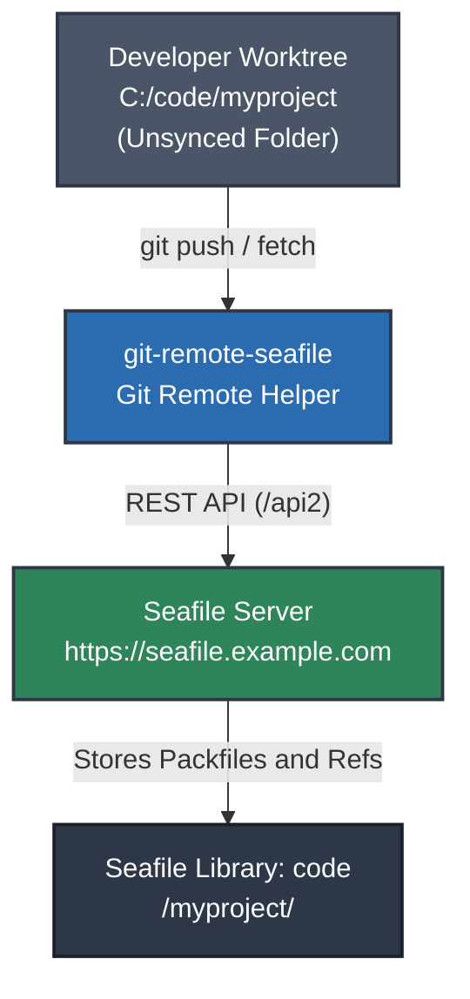

# git-remote-seafile

[](https://github.com/tkittich/git-remote-seafile/actions/workflows/ci.yml)
[](https://opensource.org/licenses/Apache-2.0)
[](https://www.python.org/downloads/)

A transparent, zero-thrash **Git remote helper** for Seafile servers.

`git-remote-seafile` allows you to use your private Seafile server (Community or Professional Edition) as an authentic, secure (HTTPS/TLS), access-controlled Git remote backend using native Git commands (`git clone`, `git push`, `git pull`).

---

## Quick Start

```bash
# 1. Install (the snapshot tool comes with it; both land on your PATH)
uv tool install git+https://github.com/tkittich/git-remote-seafile.git
#    or: pipx install git+https://github.com/tkittich/git-remote-seafile.git

# 2. Check the login and the destination. With the Seafile desktop client
#    installed and signed in there is nothing to configure.
git-remote-seafile doctor seafile://code/myproject

# 3. Use it like any other remote
cd ~/code/myproject                       # outside any Seafile-synced folder
git remote add origin seafile://code/myproject
git push -u origin main

# On another machine
git clone seafile://code/myproject
```

`code` is a library on your Seafile server. A push does not create it, but `doctor` can: run it with `--create-library` (or answer `y` when it asks on a terminal) and it makes the library with 30 days of history, which is what you want -- Git is already the history, see [User Guide 8.0.1](USER_GUIDE.md#801-library-history-setting). Or make it in the web UI (**New Library**) and set *Library settings -> History Setting* to a few days. Either way leave it **unsynced** in the desktop client. Nothing else needs configuring; every setting has a default, and `git-remote-seafile config` shows the ones in force.

No desktop client? Run `git-remote-seafile login`. For a script or CI set `SEAFILE_SERVER` and `SEAFILE_TOKEN`, or write `~/.git-seafile.json` -- [User Guide 6](USER_GUIDE.md#6-authentication--configuration). Installing from a checkout instead: `pip install -e .`. This repository ships wheels and sdists as [GitHub Release](https://github.com/tkittich/git-remote-seafile/releases) assets; PyPI publication is deferred to the official Seafile repository once this code is merged upstream.

Something not working? `git-remote-seafile doctor <url>` checks, in order, the login, how the URL is read, the safety guards and write access, and says which step failed.

---

## Critical Rule: Working Repository Placement

> [!CAUTION]
> ### DO NOT keep your working repository inside any folder synced by Seafile!
> 
> Your active Git repository (the directory containing your working tree and `.git/`) **MUST be located outside of any folder actively synced by the Seafile desktop client**.
> 
> - **Safe locations**: Any folder that Seafile does not watch or sync, such as `C:\code\myproject`, `C:\Projects\myproject`, or `~/code/myproject`.
> - **Unsafe locations**: Any local directory currently mapped to a Seafile library in your desktop client (such as `C:\Users\<username>\Seafile\...` or a synced folder).
> 
> **Why?**
> If your local repository directory is actively watched by the Seafile desktop client, the sync daemon will continuously monitor, lock, and re-index the internal `.git/` files on every commit or branch switch. `git-remote-seafile` communicates directly with your Seafile server over HTTP/HTTPS Seafile Web API (`/api2`)—just like GitHub or GitLab. Keeping your working folder unsynced allows Git to operate at native filesystem speed with zero desktop client interference.
> 
> **Need to store remotes in a synced library?**
> If you store remotes in a synced library like `Documents`, store them under an ignored subfolder such as **`seafile-git/`** (`seafile://Documents/seafile-git/myproject`) or any folder name of your choice (e.g. `git-vault/`), and add that subfolder name to `<library-root>/seafile-ignore.txt`. The name `seafile-git/` is not mandatory—any folder name works as long as it is ignored!
>
> ⚠️ **`seafile-ignore.txt` Traps**:
> - **Must be at library root**: `seafile-ignore.txt` must sit in the synced library root (subfolder ignore files are ignored by the Seafile desktop client).
> - **Never-synced files only**: It only works on files/folders that have not yet been synced; it cannot retroactively ignore already-synced folders.
>
> *(For a completely trouble-free setup, we recommend using a dedicated unsynced library instead!)*

---

## Built-in CLI Subcommands
`git-remote-seafile` provides CLI subcommands for verification, diagnostics, and lock management:

| Command | Description |
| :--- | :--- |
| `git-remote-seafile login [server] [--user NAME]` | Sign in with your username and password (and a two-factor code if the server asks) and save the API token to `~/.git-seafile.json`. For machines without the Seafile desktop client; the password is never stored. |
| `git-remote-seafile check-auth` | Verify authentication credentials against the Seafile server. |
| `git-remote-seafile config` | Show every behavioural setting (`seafile.*` git config keys and their environment variables), its effective value and where the value comes from. |
| `git-remote-seafile check-safety <url>` | Test pre-flight safety guardrails (Trap 1 & 2 path collisions). |
| `git-remote-seafile doctor [url] [--create-library] [--set-history DAYS] [--upload-limit]` | One-shot first-use check: login, how the URL is interpreted, safety guards, a write/delete probe, the library's history setting and a search for conflict copies; `--create-library` makes a missing library (30 days of history), `--set-history` changes the days kept; `--upload-limit` also measures the largest upload the server or its proxy accepts and prints the matching `seafile.gcmaxpackmib`. |
| `git-remote-seafile lock-status <url>` | Inspect remote repository lock status and lease holder details. |
| `git-remote-seafile unlock <url> [--force]` | Release a held lock or forcibly break an abandoned lock. |
| `git-remote-seafile gc <url> [--min-packs N]` | Consolidate and delta-compress remote packfiles. Fail-closed: refuses to compact if any pack fails to download or verify, or if refs sit outside heads/tags. An automatic version runs by default (`seafile.autogc`, on): after a qualifying push it tail-merges only the small packs (below half of `seafile.gcmaxpackmib`) inline, within a bounded download budget — large packs are frozen and never count toward the threshold. Set `git config seafile.autogc false` to be only warned. |
| `git-remote-seafile lfs-setup [url] [--all-remotes]` | Point Git LFS in the current repository at Seafile: writes the four `lfs.*` settings, taking the library from the repository's own `seafile://` remote. Safe to re-run; it will not send other remotes' large files to Seafile unless told to. |
| `git-remote-seafile lfs-transfer <url>` | Git LFS Custom Transfer Agent—invoked by Git LFS itself once you point it here (`git config lfs.customtransfer.seafile.*`, see [USER_GUIDE.md](USER_GUIDE.md)). No manual invocation needed. |
| `git-remote-seafile set-head <url> <branch>` | Set default branch (`HEAD`) pointer after verifying branch exists. |
| `git-remote-seafile test <url>` | Discover refs and verify connectivity without cloning. |
| `git-remote-seafile desktop-url <path>` | Convert a local synced directory path to a `seafile://` remote URL. |
| `git-remote-seafile version` | Display the helper version. |

---

## Why This Exists

Storing active Git repositories inside Seafile desktop-synced folders (e.g. `Documents/code/`) causes severe thrashing:
- A single `git commit` writes ~15 files into `.git/` in milliseconds, triggering hundreds of continuous library re-index cycles per day.
- Ephemeral `.git/*.lock` files sync across machines, freezing Git commands on secondary machines.
- Diverging edits generate destructive `(SFConflict ...)` copies instead of Git merges.

### The Solution
Instead of syncing the local `.git/` folder, `git-remote-seafile` communicates directly with the **Seafile Web API (`/api2`)**:
- **Zero Daemon Churn**: The desktop sync client never scans or indexes your working repository.
- **Automated Pre-Flight Safety**: Built-in guardrails detect and block path collisions (Trap 1) and download reflection loops (Trap 2) before any data is transferred.
- **Fast & Efficient**: Commits are packed using Git packfiles (`.pack` and `.idx`). Pushing 100 commits uploads only **two files**, with disk-staged streaming avoiding memory spikes.
- **Git LFS**: A custom transfer agent streams large assets straight into Seafile, so multi-GB models and datasets live in the library and quota you already pay for. Both directions stream — peak memory on a 64 MB transfer is **0.16 MB**, against **128 MB** for the same payload held in memory. (`tracemalloc` over 16 KiB reads; `tests/test_client.py::TestStreamingTransfers` pins the property, with a 16 MB payload required to stay under 1 MB.)
- **Concurrent Ref Discovery**: Discovers remote branches and tags concurrently using a worker pool while strictly preserving deterministic alphabetical sort order.
- **Smart Pack Filtering**: Bypasses redundant remote pack downloads during fetch when requested commits already exist locally.
- **Fast-forward Protection**: Rejects non-fast-forward pushes unless force-pushed, preventing accidental clobbering.
- **Honest Dry Runs**: `git push --dry-run` answers exactly as a real push would—same namespace and fast-forward decisions—while taking no lock, building no packfile, and writing no ref.
- **SHA-1 and SHA-256 Repositories**: The helper negotiates the remote's object format during ref listing (`option object-format` / `:object-format`), so SHA-256 repositories clone and push natively instead of producing corrupted packs.
- **Ticket-Based Distributed Locking**: Prevents push collisions with server-timestamped lock tickets (`.git-lock.d/<nonce>.json`), dead PID fast-reclaim, in-transfer lease renewal, and ownership fencing that detects a lapsed-and-taken-over lock before any destructive step.
- **Lock Management CLI**: Built-in `lock-status` and `unlock [--force]` subcommands for operator inspection and emergency recovery.

> [!NOTE]
> **Packfiles accumulate; the file count stays bounded.** Every push adds one small packfile pair, and automatic maintenance (`seafile.autogc`) is **on** by default: the helper tail-merges the *small* packs inline after a qualifying push — large packs are frozen where they stand. `git config seafile.autogc false` turns it into a tip only. Run `git-remote-seafile gc <url>` periodically for a full delta-compaction, or a long-lived remote's bytes grow without bound.

---

## Architecture Overview



---

## Is This the Right Tool?

It is a **storage and transport backend** for Git on a Seafile server you already run: no new infrastructure, your existing accounts and quota, Git LFS included. It is not a forge -- there are no pull requests, code review or CI runners -- so use GitHub, GitLab or Gitea for those, or both at once (`git remote set-url --add --push origin seafile://...` mirrors every push to Seafile).

Why not just keep the repository in a synced folder, a bare repo, a bundle or a cloud-sync client? Each was tried and fails in a way Seafile's sync model cannot avoid; the comparison and the success and failure modes of nine alternatives are in [ALTERNATIVES.md](ALTERNATIVES.md).

---

## Documentation

**Use it**

- [User's Guide (USER_GUIDE.md)](USER_GUIDE.md): Full walkthrough of setup, configuration files, multi-account usage, and dual-remote (GitHub + Seafile) setups.
- [Known limitations (USER_GUIDE.md §14)](USER_GUIDE.md#known-limitations-and-what-they-mean-for-you): The places the tool, Git or Seafile stops short — advisory locking, request and object size limits (including Git for Windows and 4 GiB files), encrypted libraries, tested-server scope, snapshot caveats — and what each means for you.
- [Snapshot Guide (SNAPSHOT_GUIDE.md)](SNAPSHOT_GUIDE.md): How to take, restore and verify a snapshot with `git seafile-snapshot`, and what it costs.
- [Upgrading (UPGRADING.md)](UPGRADING.md): What may change for you from one release to the next.
- [Changelog (CHANGELOG.md)](CHANGELOG.md): What changed in each release.

**Run it and fix it**

- [Operations Runbook (RUNBOOK.md)](RUNBOOK.md): Recovery procedures — a stuck lock, stray or conflicting refs, half-uploaded packfiles, and what to capture before opening an issue.
- [Security Policy (SECURITY.md)](SECURITY.md): Credential handling and precedence, the threat model, TLS/private-CA and proxy configuration, and how to report a vulnerability.

**Understand it**

- [Alternatives and Comparison (ALTERNATIVES.md)](ALTERNATIVES.md): How this compares with a git forge, and why each workaround for keeping a repository in a synced folder fails.
- [Snapshot Tool Design (SNAPSHOT.md)](SNAPSHOT.md): The design of the whole-tree snapshot tool — the vault, byte-exactness, multi-machine semantics, and the measured cost model.
- [Architecture & Design Spec (DESIGN.md)](DESIGN.md): Technical protocol specifications and upstream RFC for Seafile maintainers.
- [Payload Mode Specification (PAYLOAD.md)](PAYLOAD.md): Large files stored by hash instead of through git — requirements, decisions, failure model and the adversarial review.
- [Engineering Roadmap (ROADMAP.md)](ROADMAP.md): Prioritized features, architectural backlog, and version milestones.

**Contribute**

- [Contributing Guidelines (CONTRIBUTING.md)](CONTRIBUTING.md): How to contribute, run tests, and adhere to development standards.
- [Code of Conduct (CODE_OF_CONDUCT.md)](CODE_OF_CONDUCT.md): The standard this project adopts, and how to report a problem.

### Whole-tree snapshots: `git seafile-snapshot`

A `.gitignore`d file never enters a commit, so **no remote helper can carry it** — `.env`, a local database, build output. `git seafile-snapshot` closes that gap: it captures the working tree **as it lies on disk**, ignored files and all, into versioned, byte-exact snapshots in a Seafile library, over the same transport the helper uses.

> [!NOTE]
> **Installed with the package.** `pip install git-remote-seafile` provides the helper (`git-remote-seafile`) *and* the snapshot tool as `git-seafile-snapshot` — so `git seafile-snapshot` works anywhere git finds it on `PATH` — and as `git-remote-seafile snapshot`. From a source checkout, `git seafile-snapshot` runs the same program (the file is a thin wrapper around `git_remote_seafile/snapshot_tool.py`, so existing commands and scheduled jobs keep working). (`git seafile-snapshot --help` is intercepted by git, which looks for a man page: ask with `-h`, or run `git-seafile-snapshot --help`.) The diagnostics script `tools/seafile_doctor.py` below still ships with the source and the sdist only.

> [!WARNING]
> **A snapshot copies the whole tree, so it holds what you would never commit.** The vault will contain `.env`, keys and local databases — that is the point — so push it to a library whose access matches the secrets it carries. Nested Git repositories are captured as their files, but not their `.git` (history, branches, stashes), so back that up separately. Symlinks are stored faithfully (a `120000` entry holding the target path), but a restore onto Windows without Developer Mode turns each one back into a text file containing that path. The byte-for-byte check that runs after **every** restore (not only under `--verify`) then names it as a mismatch and **aborts the restore** — the vault is intact, so re-running with `core.symlinks` enabled reproduces the links.

Every option has a default, so the first run is the only one that needs an argument — and later runs can be a bare command:

```bash
cd C:/code/myproject

# Snapshot into C:/code/myproject-vault and push it to Seafile, inferring the
# destination from the source repo's own seafile:// remote
git seafile-snapshot

# Preview it: the vault is initialised if missing and the snapshot staged into
# its index, so the diff you see is real -- nothing is pushed and no setting changes
git seafile-snapshot --dry-run

# Restore into a fresh directory, verifying byte-exactness on the way
git seafile-snapshot --restore --remote seafile://code/myproject-vault \
    --into C:/restore/myproject
```

> [!WARNING]
> **Upgrading to 0.9.0: payload mode is on by default.** A vault whose tree holds files of 64 MiB or more (or 4 MiB or more that do not compress) moves them out of git on its next snapshot, uploads them as payload objects (one full pass; stored twice on the server, since the old blobs stay in the history), and `git diff` shows them deleted. Older snapshots restore as before; newer ones need the payload, **and 0.8.8 cannot restore them completely** (it restores the tree without the large files). A plain `git clone` of a payload vault does not contain the large files either. Vaults with no such file are unaffected. To keep a vault exactly as it was, run once with `--no-payload`; the vault remembers it. See [SNAPSHOT_GUIDE.md §9](SNAPSHOT_GUIDE.md#9-large-payloads-payload-mode).

**Scripting and trust:** `--json` writes one JSON document to stdout (the text goes to stderr) and `--exit-warnings` exits 3 for a run that completed with a warning, so a scheduled job can alert on anything unusual; `--restore-drill` restores the newest snapshot into a temporary directory, checks it byte-for-byte and `git fsck`, samples the payload by SHA-256 and deletes it, so the first restore is not the day you need one.

**Large trees:** payload mode (on by default; `--no-payload` turns it off) stores big, already-compressed files on the server by hash instead of through git — no second local copy, no staging pass, and a snapshot that costs nothing to keep; each run says where its files went, and the cut-off for compressible files is tunable (`--payload-auto-ratio`). A 131 GiB tree took 38 minutes and restored byte-exact. See [SNAPSHOT_GUIDE.md §9](SNAPSHOT_GUIDE.md#9-large-payloads-payload-mode) and [PAYLOAD.md](PAYLOAD.md).

The destination, branch and exclusions are **remembered in the vault** after the first run, so a scheduled job can be nothing more than `git seafile-snapshot`. It maintains a **separate vault repository** whose `--work-tree` is the source, so the source stays read-only and untouched. Byte-exactness is enforced with `core.autocrlf=false` plus `* -text -filter -ident -working-tree-encoding` in the vault's own `info/attributes` — a plain `git clone` of the vault silently loses that, which is why `--restore` exists. Recommended junk exclusions are **never applied silently**: an unattended run captures everything and tells you what it noticed, and a first run at a terminal lists the reproducible directories it found (`node_modules`, virtualenvs, `dist`) with their sizes and asks, because a backup that quietly omits a file is worse than a large one. See [SNAPSHOT_GUIDE.md](SNAPSHOT_GUIDE.md) for the walkthrough and [SNAPSHOT.md](SNAPSHOT.md) for the full design.

### Diagnostics for the Seafile desktop client

> Not to be confused with `git-remote-seafile doctor <url>`, which checks a *destination* (login, URL interpretation, write access). `tools/seafile_doctor.py` below is about the Seafile desktop **sync client**.

`tools/seafile_doctor.py` is a read-only diagnostic for the Seafile **sync
client**. It is for the case the [Critical Rule](#critical-rule-working-repository-placement)
above is about: a repository that has been living inside a synced library, where
you need to see what the client did. It answers questions `git status` cannot,
because the evidence lives in the client's own databases rather than in the
working tree.

```bash
python tools/seafile_doctor.py report    # everything below, in one pass
python tools/seafile_doctor.py libs      # which libraries are synced, and where
python tools/seafile_doctor.py where ~/Documents/code/app   # is this inside a synced library? (exit 1 = no, exit 2 = could not check)
python tools/seafile_doctor.py errors    # the client's sync-error table, decoded
python tools/seafile_doctor.py conflicts # the *SFConflict* residue, by month
python tools/seafile_doctor.py churn     # re-commit / upload cycles per day
python tools/seafile_doctor.py identity  # machine-identity history

`report` runs libs, identity, errors, conflicts and churn (not `where`,
which needs a path argument).
```

It copies the client's databases to a temporary directory before opening them,
so a running client is never blocked or torn, and it never writes anything back.
Like the snapshot tool above, it ships with the source checkout and the sdist
rather than the wheel.

---

## Acknowledgments & Inspirations

`git-remote-seafile` builds upon pioneering work in the Git remote helper and cloud storage ecosystem:
- [git-remote-dropbox](https://github.com/anishathalye/git-remote-dropbox) by Anish Athalye: The landmark implementation that demonstrated transparent Git packfile transport and distributed locking over cloud storage APIs.
- [git-remote-gcrypt](https://spwhitton.name/tech/code/git-remote-gcrypt/) by Joey Hess: Pioneered decentralized, encrypted Git remotes.
- [git-remote-s3](https://github.com/jason-riddle/git-remote-s3): Git remote helper for Amazon S3 object stores.
- [Git Remote Helpers Protocol Specification](https://git-scm.com/docs/git-remote-helpers): Official Git documentation on building custom remote helpers.
- [Git LFS Custom Transfer Agent Protocol](https://github.com/git-lfs/git-lfs/blob/main/docs/custom-transfers.md): Specification for custom large-object transport agents.
- [Seafile Web API v2](https://manual.seafile.com/develop/web_api_v2/): The underlying REST API provided by Seafile Ltd.

---

## AI Disclosure & Authorship

This project—including its source code, test suites, architecture design, and documentation—was authored primarily with generative AI assistance from multiple AI systems, in collaboration with human architectural design, real-world forensic diagnostics, and verification by [@tkittich](https://github.com/tkittich). All code and protocol implementations are fully open source, tested on Windows (with GitHub Actions CI configured for cross-platform runs), and licensed under the Apache License 2.0.

---

## License

Licensed under the [Apache License, Version 2.0](LICENSE).
